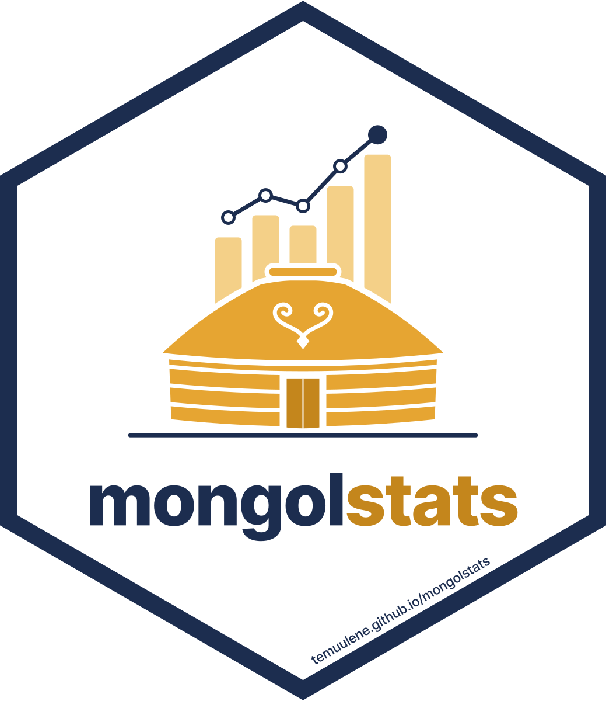
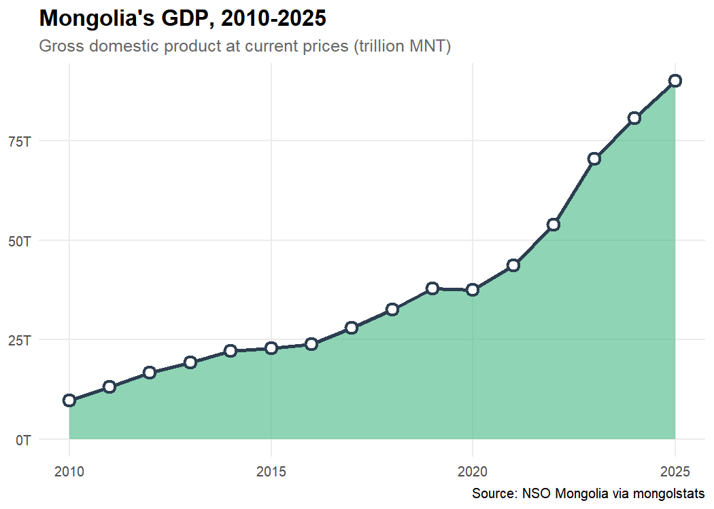
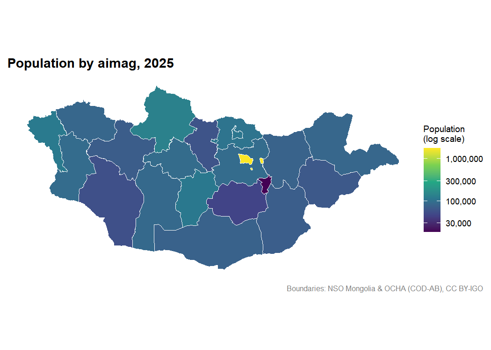

<!-- README.md is generated from README.Rmd. Please edit that file -->

# mongolstats 

<p class="language-switch">

<a href="https://temuulene.github.io/mongolstats/mn/" lang="mn" hreflang="mn">Монгол
хэлээр</a>
</p>

<!-- badges: start -->

[](https://github.com/temuulene/mongolstats/actions/workflows/R-CMD-check.yaml)
[](https://lifecycle.r-lib.org/articles/stages.html#experimental)
<!-- badges: end -->

**mongolstats** is your gateway to the [National Statistics Office of
Mongolia (NSO)](https://data.1212.mn/). Access official data, analyze
economic trends, and map regional statistics—all from within R.

## Why mongolstats?

- **Instant Access:** Query thousands of official datasets directly from
  R.
- **Tidy Data:** Analysis-ready tibbles with English or Mongolian
  labels.
- **Stable Periods:** Years and months come back as labels such as
  `"2024"` or `"2024-03"`, and can be selected in any NSO period format.
- **Resilient:** Tables that NSO moves within its catalogue are found
  automatically, and large requests are split to stay within the
  server’s limits.
- **Mapping Ready:** Results join by NSO code to the maps in the
  companion package
  [mongolmaps](https://github.com/temuulene/mongolmaps).

## Installation

You can install mongolstats from CRAN with:

``` r
install.packages(c("mongolstats", "mongolmaps"))
```

Or install the development version from [GitHub](https://github.com/)
with the released mongolmaps from CRAN:

``` r
# install.packages("pak")
pak::pak(c("temuulene/mongolstats", "cran::mongolmaps"))
```

## Quick Start

### 1. The Economic Pulse: GDP Trends

Find a table, then fetch it with selections written as codes or labels:

``` r
library(mongolstats)
library(dplyr)
library(ggplot2)

nso_search("gross domestic product, by production approach") |>
  select(tbl_id, tbl_eng_nm)
#> # A tibble: 7 × 2
#>   tbl_id              tbl_eng_nm                                                
#>   <chr>               <chr>                                                     
#> 1 DT_NSO_0500_001V4   GROSS DOMESTIC PRODUCT, by production approach, by econom…
#> 2 DT_NSO_0500_001V6   GROSS DOMESTIC PRODUCT, by production approach, by econom…
#> 3 DT_NSO_0500_004V1   GROSS DOMESTIC PRODUCT, by production approach, by econom…
#> 4 DT_NSO_0500_022V1   GROSS DOMESTIC PRODUCT, by production approach, by econom…
#> 5 DT_NSO_0500_022V1-1 GROSS DOMESTIC PRODUCT, by production approach, by econom…
#> 6 DT_NSO_0500_001V1   GROSS DOMESTIC PRODUCT, by production approach, by econom…
#> 7 DT_NSO_0500_001V3   GROSS DOMESTIC PRODUCT, by production approach, by econom…

gdp <- nso_data(
  tbl_id = "DT_NSO_0500_001V1",
  selections = list(
    "Statistical indicator" = "GDP, at current prices",
    "Economic activity" = "Total",
    Year = nso_period_seq("2010", "2025")
  )
)

# Years come back as labels, newest first; "2025*" marks a preliminary figure
head(gdp, 3)
#> # A tibble: 3 × 4
#>   `Statistical indicator` `Economic activity` Year      value
#>   <chr>                   <chr>               <chr>     <dbl>
#> 1 0                       0                   2025* 89937128.
#> 2 0                       0                   2024  80663051.
#> 3 0                       0                   2023  70441516.

gdp |>
  ggplot(aes(x = nso_period_date(Year), y = value / 1e6)) +
  geom_area(fill = "#42b883", alpha = 0.6) +
  geom_line(color = "#2c3e50", linewidth = 1.2) +
  geom_point(color = "#2c3e50", size = 3, shape = 21, fill = "white", stroke = 1.5) +
  scale_y_continuous(labels = scales::label_number(suffix = "T")) +
  labs(
    title = "Mongolia's GDP, 2010-2025",
    subtitle = "Gross domestic product at current prices (trillion MNT)",
    x = NULL,
    y = NULL,
    caption = "Source: NSO Mongolia via mongolstats"
  ) +
  theme_minimal(base_size = 12) +
  theme(
    plot.title = element_text(face = "bold", size = 16),
    plot.subtitle = element_text(color = "grey40"),
    panel.grid.minor = element_blank()
  )
```



### 2. Mapping Regional Population

NSO tables identify places by code.
[mongolmaps](https://github.com/temuulene/mongolmaps) boundaries carry
the same codes, so `mn_join()` attaches a table to the map in one step,
keeping the aimags and dropping the national and regional totals:

``` r
library(mongolmaps)

pop_tbl <- "DT_NSO_0300_002V1"
latest <- nso_latest_periods(pop_tbl)

pop <- nso_data(pop_tbl, selections = list(Year = latest))

pop |>
  mn_join(by = "Region", level = "aimag") |>
  mn_map(fill = value, trans = "log10", lang = "en", title = paste("Population by aimag,", latest)) +
  labs(fill = "Population\n(log scale)")
```



## Sources and metadata

The 0.4 workflow adds reviewed indicator queries, source citations,
durable provenance manifests, and source-value status. Start with a
concept, inspect its definition and unit, then keep the original status
records alongside an export.

``` r
nso_indicators("GDP")
nso_indicator("gdp_current")
gdp <- nso_indicator_query("gdp_current", periods = c("2023", "2024")) |>
  nso_fetch(labels = "en")
nso_table_info(gdp)
nso_citation(gdp)
nso_value_status(gdp)
nso_write_manifest(gdp, "gdp-provenance.json")

# Discover definitions and the separate public portal.
nso_metadata("indicator", 12925)
nso_indicators(source = "portal")
```

Portal identifiers and geography codes use their own source scheme;
missing official labels remain missing. Datamart support provides
discovery only. Open the bilingual source and metadata guide with
`vignette("data-provenance", package = "mongolstats")` for exports,
quality checks, classification codebooks, catalog freshness, and the
limits of the experimental services.

## Documentation

Full documentation is available at
[temuulene.github.io/mongolstats](https://temuulene.github.io/mongolstats/).

- [Getting
  Started](https://temuulene.github.io/mongolstats/articles/getting-started.html) -
  Your first epidemiological analysis
- [Discovery
  Guide](https://temuulene.github.io/mongolstats/articles/discovery.html) -
  Find and explore tables
- [Mapping
  Guide](https://temuulene.github.io/mongolstats/articles/mapping.html) -
  Map NSO data with mongolmaps

## Contributing

We welcome contributions! Please see the [Contributing
Guidelines](https://github.com/temuulene/mongolstats/blob/main/CONTRIBUTING.md)
for details.

## License

MIT
